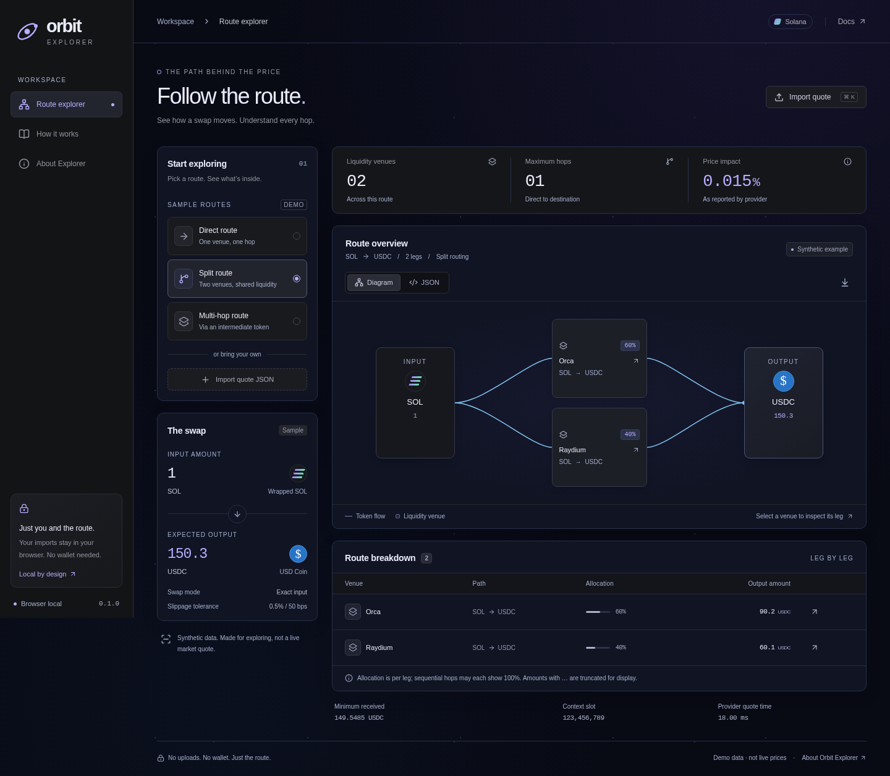

# Orbit Explorer

**Follow the route behind a swap.**

A small, browser-local tool for understanding Metis-compatible swap quotes on
Solana. Explore direct, split, and multi-hop examples, or bring your own quote JSON.
No wallet, API key, or server is required.

All included quotes are **synthetic educational examples**, not live market prices.
Live quote requests and trade execution are outside the current release.



## Run locally

Use Node.js 22.12 or newer and npm.

```sh
npm ci
npm run dev
```

Open the local URL printed by Vite. For a production build:

```sh
npm run build
npm run preview
```

## What you can do

- Explore three sample route shapes with a token-flow diagram and leg breakdown.
- Select a venue to inspect its pool, exact input/output units, and reported fee.
- Paste a quote or import a JSON file, including a `quoteResponse` wrapper.
- Inspect, copy, and download validated quote fields.
- Read a short guide to hops, allocations, slippage, thresholds, and unknown tokens.

Imports are parsed in memory and disappear on reload. The app does not upload
quotes, persist them, connect a wallet, or contact an RPC or quote provider. Assets
are served locally; there are no external fonts, token images, or analytics.

## Supported input

The adapter follows the [Metis `/quote` response](https://metis.builders/api-reference/quote)
shape: token mints, atomic amount strings, swap mode, slippage, price impact, and
`routePlan` legs. See [the synthetic sample](public/sample-quote.json) for a complete
example. This is a visualization format adapter, not a complete transaction SDK.

- Imports are limited to 1 MiB and 64 route legs.
- Routes must connect distinct input/output tokens without cycles.
- Token amounts use exact string/integer formatting. An ellipsis marks truncated
  display digits; JSON retains the full atomic amount.
- Known token decimals are bundled. Unknown tokens show their mint and raw base
  units rather than guessed balances.
- Each leg has its own allocation. Multi-hop allocations need not sum to 100%.
- Unsupported fields are discarded. Downloaded JSON contains the validated subset,
  so it is **not a round-trip replacement for the original API response**.
- Imports are snapshots. Explorer does not verify freshness, liquidity, or whether
  a quote can execute.

## Project structure

```text
src/
  App.tsx                 Application state and explorer workspace
  components/             Diagram, import dialog, token icons, and guide
  data/samples.ts         Fictional demonstration quotes
  lib/quote.ts            Validation, token metadata, formatting, route stats
  lib/quote.test.ts       Domain tests
  styles.css              Shared visual tokens and responsive styles
tests/                    Browser journeys
public/                   Favicon and downloadable sample quote
docs/                     Architecture and design notes
```

## Verify changes

```sh
npm run check
npx playwright install chromium
npm run test:e2e
```

The first command checks formatting, TypeScript, unit tests, and the production
build. Browser tests exercise the real interface on desktop and mobile.

## Hosting

The build produces `dist/`, which can be served by any static host. Relative asset
paths support both a domain root and a GitHub Pages repository subdirectory.

For GitHub Pages, enable **Settings → Pages → Source: GitHub Actions**, then run the
included **Deploy Pages** workflow manually. CI runs independently on pushes and
pull requests. Nothing deploys automatically when you first push the project.

`main` is the only permanent branch; changes use short-lived topic branches and
pull requests. The [GitHub setup guide](docs/github-setup.md) includes a ready-to-import
branch ruleset and the owner-only steps for visibility and Pages.

See [CONTRIBUTING.md](CONTRIBUTING.md), [architecture](docs/architecture.md), and
[design](docs/design.md) for maintenance guidance. Released under the MIT license.

Orbit Explorer is independent and is not affiliated with or endorsed by Jupiter
or Metis.
